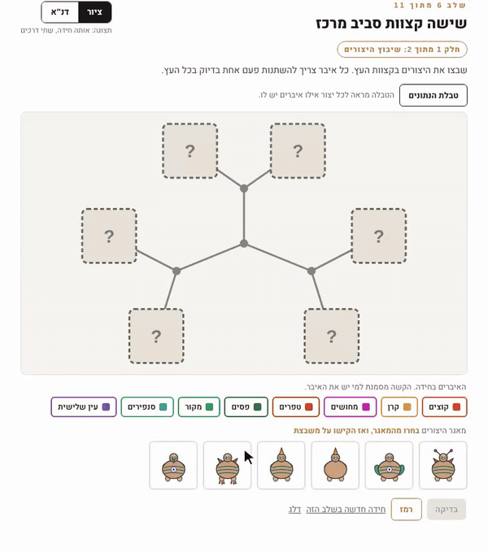
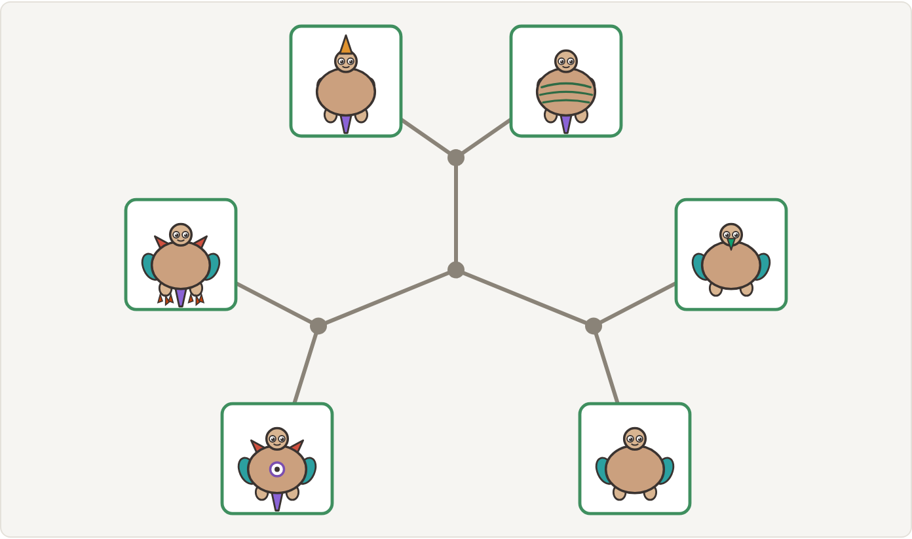
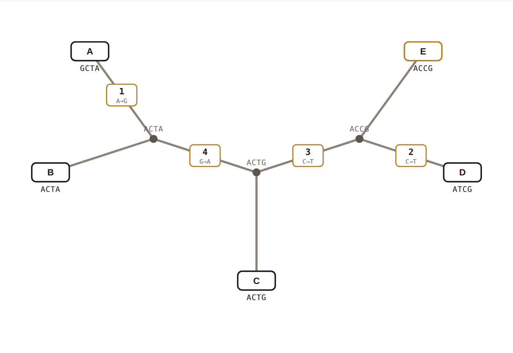

# Mutations

**A daily puzzle that teaches how evolutionary trees are reconstructed, and the engine behind it.**

Play the daily puzzle at **[mutationsgame.com](https://mutationsgame.com)**.
Try the extended game and the sequence tool at **[mutationsgame.netlify.app](https://mutationsgame.netlify.app)**.

<p align="center"></p>

<p align="center">
  
  
</p>

This repository holds the puzzle engine shared by both versions of the game, the extended game, the sequence tool, and the tests. The live daily site (its interface, its table of pre-generated puzzles and its statistics backend) lives in a separate private repository, so that future puzzles cannot be read in advance.

## The idea

Creatures carry binary body parts: a horn, a sail, spots, a tail. Species evolve by gaining or losing one part at a time, so a set of creatures can be arranged on a tree in which every line represents a single mutation. In computational biology this is a **perfect phylogeny**: a tree in which every character changes exactly once. Two classic facts make it a good subject for a game:

* a set of binary characters admits a perfect phylogeny **if and only if** no two characters show all four combinations `00, 01, 10, 11` across the species (the **four-gamete test**), and
* when the test passes, the tree can be built by a simple recursive algorithm and is essentially unique.

The daily puzzle asks the player to build such a tree. The extended version turns it into the real reconstruction problem, where only the present-day species are known. The sequence tool runs the algorithm on DNA.

## The daily puzzle

Twelve positions on an unrooted tree, fourteen creatures in the tray, and one rule: **every line must join two creatures that differ in exactly one body part**. Nine positions are filled from the tray, five tray creatures are impostors that belong nowhere, one position must be *built* by the player from body parts, and two positions offer short lists of candidates. The same puzzle is served to everyone on a given day.

### How the generator guarantees one solution, reachable without guessing

`src/engine/daily/generator.js` grows a random tree one body part at a time, chooses the special positions so that each has a unique answer, and picks impostors that are "almost right" (one step away from a real creature). A candidate puzzle is then handed to `src/engine/daily/fairness.js`, which rejects it unless two things hold:

1. **Uniqueness.** Every complete solution is the same tree, up to swapping two end creatures that hang on the same creature (the drawing mirrored).
2. **Deduction only.** A solver that never guesses reaches the solution. It keeps, for every position, the set of creatures that could still sit there, and repeats three rules until nothing changes: *support* (a creature stays in a position only if every neighbouring position still has an option exactly one step away), *single* (a position with one option is settled, and that creature leaves every other position) and *pair* (two positions with the same two options take both). If the rules stall, the only branching allowed is one where every option leads to the same tree.

Running this solver on the first twenty hand-picked puzzles of the site showed that seven were not fair (three needed a guess, four had several valid trees), and exposed two generator bugs. With the check in the loop, every published puzzle is fair by construction. The test `tests/daily-fairness.test.mjs` regenerates a few puzzles from test seeds and re-checks them.

## The extended game: leaves only

In real phylogenetics we can sample only the leaves of the tree, never the ancestors. The extended game (`src/ui/game`) therefore shows the creatures at the *ends* of an unrooted tree, and the rule becomes: **every body part changes exactly once in the whole tree**, i.e. there is a single line separating all creatures that have the part from all that do not. Checking is done against the rule, not against a stored solution, so every symmetric placement is accepted.

What it adds:

* **Fixed skeletons.** Up to six leaves there are only four tree shapes (one with four, one with five, two with six), so the same skeletons serve every puzzle, and puzzles are generated in constant time by dealing body parts to edges (`src/engine/extended/generator.js`).
* **Traits on the edges.** In some levels the player also places every body part on the edge where it changes; after a correct solution the hidden ancestors are drawn at the internal vertices.
* **Drawing or DNA.** Every puzzle can be viewed as creatures or as short DNA sequences, one site per body part, and the switch works at any moment.
* **No tree.** Advanced levels may contain data that admit no perfect phylogeny. The player must say so and prove it by selecting two characters and four creatures that show all four combinations.
* **Unknown shape.** In the last levels the player first chooses which of the two six-leaf shapes fits the data; the generator guarantees that exactly one does.

## The sequence tool

`src/engine/phylogeny/analyze.js` reads DNA sequences (FASTA or one per line), re-encodes every site relative to a reference taxon, runs the four-gamete test on every pair of sites, and either builds the perfect phylogeny by the recursive construction, with ancestral sequences, Newick export and rooted/unrooted drawings, or returns the two sites and four taxa that certify that no tree exists. On the textbook example it reproduces the textbook tree.

The theory, including a full proof of the four-gamete theorem, is in [`docs/four-gamete-proof.pdf`](docs/four-gamete-proof.pdf). The project was supervised by Prof. Ilan Gronau at Reichman University.

## Layout

```
src/engine/            pure JavaScript, no React, runs in node
  creatures.js         traits, distance, canonical keys, seeded randomness
  daily/generator.js   the daily puzzle generator
  daily/fairness.js    uniqueness + deduction-only solver
  extended/            fixed skeletons, dealing generator, the rule and its consequences
  phylogeny/           step 0, four-gamete test, construction, layouts
src/ui/                React components (Hebrew interface)
  Creature.jsx         the parametric SVG creature
  game/                the extended game
  tool/                the sequence tool
tests/                 node --test, no extra dependencies
docs/                  proof, screenshots
```

## Running

```
npm install
npm run dev      # development server
npm run build    # static site in dist/
npm test         # engine tests (about 30 seconds; the daily generator is slow by design)
```

Requires Node 18 or newer.

## License

MIT.
